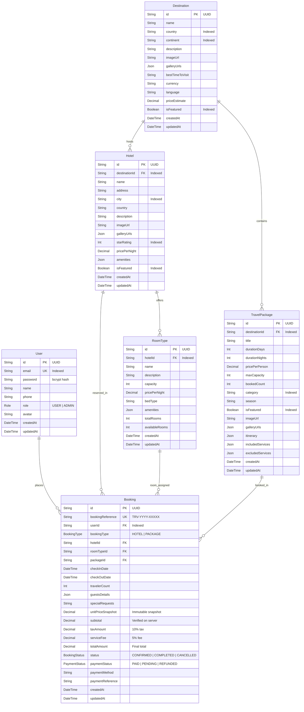
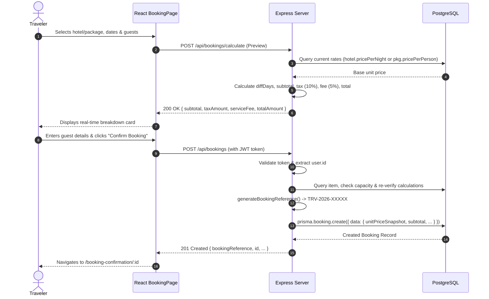
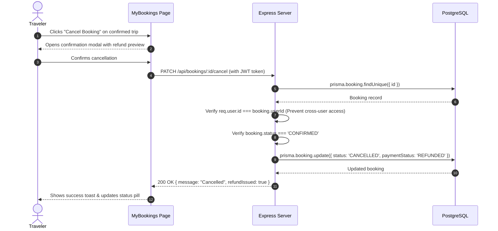

# TravelAI System Architecture & Code Structure Documentation

This document provides a comprehensive technical reference for the **TravelAI** platform architecture, data model, business logic engines, security controls, and directory structure.

---

## Table of Contents
1. [High-Level Architectural Overview](#1-high-level-architectural-overview)
2. [Full Codebase & Directory Structure](#2-full-codebase--directory-structure)
3. [Database Architecture & Entity Relationships](#3-database-architecture--entity-relationships)
4. [Security & Authentication Architecture](#4-security--authentication-architecture)
5. [Server-Side Pricing Engine & Business Rules](#5-server-side-pricing-engine--business-rules)
6. [Frontend Architecture & Component Hierarchy](#6-frontend-architecture--component-hierarchy)
7. [RESTful API Endpoints Catalog](#7-restful-api-endpoints-catalog)
8. [Workflow Sequence Diagrams](#8-workflow-sequence-diagrams)
9. [Error Handling & Reliability](#9-error-handling--reliability)
10. [Local Development & Production Deployment](#10-local-development--production-deployment)

---

## 1. High-Level Architectural Overview

TravelAI is engineered using a **Decoupled Client-Server Architecture** composed of:
1. **A Single-Page Application (SPA) Frontend**: Built with React 18, Vite, React Router v6, Tailwind CSS, and Axios.
2. **A Stateless RESTful Backend Application**: Built on Node.js and Express.js, organized into modular routes, middleware, controllers, and utility services.
3. **A Relational Data Layer**: PostgreSQL accessed via Prisma ORM v6, providing strict schemas, type safety, migrations, and declarative indexes.

```mermaid
graph TB
    subgraph ClientLayer ["Client Presentation Layer (React + Vite)"]
        Browser["User Web Browser"]
        AuthCtx["AuthContext (JWT + Session State)"]
        ToastCtx["ToastContext (Feedback Engine)"]
        Axios["Axios Interceptor Layer"]
        Router["React Router v6 Layouts"]
    end

    subgraph APILayer ["Backend Application Gateway (Express REST API)"]
        CORS["CORS & Cookie Parser"]
        AuthMiddleware["authenticate & authorizeAdmin Middleware"]
        Controllers["Domain Controllers (Auth, Destination, Hotel, Package, Booking, Stats)"]
        PricingEngine["Server-Side Pricing & Date Validation Engine"]
    end

    subgraph DataLayer ["Persistence Layer (Prisma ORM & PostgreSQL)"]
        Prisma["Prisma Client v6 Singleton"]
        PG[("PostgreSQL 18 Database")]
    end

    Browser --> Router
    Router --> AuthCtx
    Router --> ToastCtx
    AuthCtx --> Axios
    Axios -->|HTTP REST Requests (Bearer Token / Cookie)| CORS
    CORS --> AuthMiddleware
    AuthMiddleware --> Controllers
    Controllers --> PricingEngine
    Controllers --> Prisma
    Prisma --> PG
```

---

## 2. Full Codebase & Directory Structure

```
Travel booking platform/
├── package.json                      # Root workspace scripts (dev, test, prisma, install)
├── .gitignore                        # Git exclusion rules
├── README.md                         # Project overview, quickstart, and features
├── ARCHITECTURE.md                   # Complete architectural & technical specification
│
├── server/                           # Backend Application
│   ├── package.json                  # Server dependencies & test scripts
│   ├── .env                          # Local server environment configuration
│   ├── .env.example                  # Template server environment variables
│   │
│   ├── prisma/
│   │   ├── schema.prisma             # Relational data schema, models, enums & indexes
│   │   └── seed.js                   # Idempotent seed script with verified sample data
│   │
│   ├── __tests__/
│   │   └── api.test.js               # Jest & Supertest integration test suite (16 tests)
│   │
│   └── src/
│       ├── server.js                 # HTTP listener & process startup
│       ├── app.js                    # Express application setup, CORS, routes & handlers
│       │
│       ├── routes/
│       │   ├── authRoutes.js         # /api/auth routes
│       │   ├── destinationRoutes.js  # /api/destinations routes
│       │   ├── hotelRoutes.js        # /api/hotels routes
│       │   ├── packageRoutes.js      # /api/packages routes
│       │   ├── bookingRoutes.js      # /api/bookings routes
│       │   └── adminRoutes.js        # /api/admin privileged routes
│       │
│       ├── controllers/
│       │   ├── authController.js     # Register, login, logout, me, profile, change-password
│       │   ├── destinationController.js # Destination CRUD & relation lookups
│       │   ├── hotelController.js    # Hotel CRUD & room inventory handlers
│       │   ├── packageController.js  # Package CRUD & capacity management
│       │   ├── bookingController.js  # Pricing preview, booking create, list, cancel, status
│       │   └── statsController.js    # Admin metrics aggregation & user directory
│       │
│       ├── middleware/
│       │   ├── authMiddleware.js     # JWT verification & RBAC authorization
│       │   ├── errorHandler.js       # Centralized 404 and 500 error responses
│       │   └── validateRequest.js    # Input sanitization & field validation
│       │
│       └── utils/
│           ├── prisma.js             # Singleton Prisma Client instance
│           ├── jwt.js                # Token signing & decoding helpers
│           └── referenceGenerator.js # TRV-YYYY-XXXXX reference code algorithm
│
└── client/                           # Frontend Application
    ├── package.json                  # Client dependencies (React, Vite, Tailwind, Lucide)
    ├── vite.config.js                # Vite configuration with /api reverse proxy
    ├── tailwind.config.js            # Custom color palette, fonts, and shadow tokens
    ├── postcss.config.js             # PostCSS Tailwind & Autoprefixer plugin configuration
    ├── index.html                    # HTML5 entry document with Inter font linkages
    ├── .env                          # Frontend API base URL configuration
    │
    └── src/
        ├── main.jsx                  # React DOM root with BrowserRouter & Providers
        ├── App.jsx                   # Central route registry (Public + Admin layouts)
        ├── index.css                 # Tailwind directives, custom scrollbars, glass styles
        │
        ├── services/
        │   └── api.js                # Axios client with interceptors & typed API modules
        │
        ├── context/
        │   ├── AuthContext.jsx       # Authentication state, login/register/logout handlers
        │   └── ToastContext.jsx      # Animated toast notifications dispatch engine
        │
        ├── layouts/
        │   ├── MainLayout.jsx        # Public layout (Sticky Navbar, Outlet, Footer)
        │   └── AdminLayout.jsx       # Admin layout (Protected Sidebar, Header, RBAC gate)
        │
        ├── components/
        │   ├── Navbar.jsx            # Responsive navigation with user dropdown & mobile drawer
        │   ├── Footer.jsx            # Brand info, quick links, newsletter form, disclaimer
        │   ├── Hero.jsx              # Hero banner with multi-category search tab bar
        │   ├── DestinationCard.jsx   # Destination presentation card with price estimate
        │   ├── HotelCard.jsx         # Hotel card with star ratings, amenities & location
        │   ├── PackageCard.jsx       # Travel package card with duration, price & highlights
        │   ├── Modal.jsx             # Accessible modal dialog with Esc key listener
        │   ├── EmptyState.jsx        # Configurable empty states with action triggers
        │   └── LoadingSkeleton.jsx   # Card, table, and detail shimmer skeletons
        │
        └── pages/
            ├── Home.jsx              # Hero, popular destinations, featured hotels, packages, testimonials
            ├── Destinations.jsx      # Search, continent filters, price sorting, pagination
            ├── DestinationDetail.jsx # Gallery, travel essentials, related hotels & packages
            ├── Hotels.jsx            # Hotel catalog with star rating filter, price sorting
            ├── HotelDetail.jsx       # Property gallery, full amenities list, room types inventory
            ├── Packages.jsx          # Travel packages with category and duration filters
            ├── PackageDetail.jsx     # Day-by-day itinerary accordion, inclusions, remaining spots
            ├── BookingPage.jsx       # Server price preview calculation, guest forms, demo payment
            ├── BookingConfirmation.jsx # Digital confirmation, printable receipt, booking reference
            ├── Login.jsx             # Auth form with 1-click Demo Customer & Admin autofill buttons
            ├── Register.jsx          # Registration form with immediate auto-login session
            ├── MyBookings.jsx        # User bookings with status tabs and self-service cancellation
            ├── Profile.jsx           # User profile editor and password change form
            ├── About.jsx             # Company mission, core principles, leadership team, stats
            ├── Contact.jsx           # Inquiry dispatch form, headquarters info, interactive FAQ
            ├── NotFound.jsx          # 404 recovery page
            │
            └── admin/
                ├── AdminDashboard.jsx    # Metrics cards (Revenue, Bookings, Hotels) & recent orders
                ├── AdminDestinations.jsx # Destinations CRUD table with Create/Edit/Delete modals
                ├── AdminHotels.jsx       # Hotels CRUD table with Room Types inventory manager
                ├── AdminPackages.jsx     # Packages CRUD table with multi-day itinerary editor
                ├── AdminBookings.jsx     # All customer bookings ledger with status updater
                └── AdminUsers.jsx        # Registered users directory with security role badges
```

---

## 3. Database Architecture & Entity Relationships

The PostgreSQL database is managed via **Prisma ORM**. The data models enforce referential integrity, indexes for high-frequency queries, and immutable price snapshots.

### Entity Relationship Diagram



### Price Snapshot Pattern
When a hotel room or travel package is booked, the `unitPriceSnapshot`, `subtotal`, `taxAmount`, `serviceFee`, and `totalAmount` are copied directly into the `Booking` record. If an administrator later alters the rate of the hotel room or package, historical bookings remain completely accurate and immutable.

---

## 4. Security & Authentication Architecture

```mermaid
sequenceDiagram
    autonumber
    actor User as Client Browser
    participant API as Express Gateway
    participant Auth as Auth Middleware
    participant JWT as JWT Utility
    participant DB as PostgreSQL (Prisma)

    User->>API: POST /api/auth/login { email, password }
    API->>DB: prisma.user.findUnique({ email })
    DB-->>API: User Record with bcrypt password
    API->>API: bcrypt.compare(password, hash)
    alt Password Invalid
        API-->>User: 401 Unauthorized { success: false, message: "Invalid credentials" }
    else Password Valid
        API->>JWT: generateToken({ id, email, role })
        JWT-->>API: Signed JWT Token (7d expiration)
        API-->>User: 200 OK + JWT Token + User Profile Payload
    end

    Note over User, API: Authenticated Request to Protected Route
    User->>API: GET /api/bookings/my (Header: "Authorization: Bearer <token>")
    API->>Auth: authenticate(req, res, next)
    Auth->>JWT: verifyToken(token)
    JWT-->>Auth: Decoded Payload { id, email, role }
    Auth->>DB: prisma.user.findUnique({ id })
    DB-->>Auth: Verified User Record
    Auth-->>API: req.user = verifiedUser; next()
    API->>DB: prisma.booking.findMany({ where: { userId: req.user.id } })
    DB-->>API: Customer's Private Bookings
    API-->>User: 200 OK [ User Bookings ]
```

### Role-Based Access Control (RBAC)
- Public routes (`GET /api/destinations`, `GET /api/hotels`, `GET /api/packages`) require no authentication.
- Customer routes (`POST /api/bookings`, `GET /api/bookings/my`, `PATCH /api/bookings/:id/cancel`, `GET /api/auth/me`) require the `authenticate` middleware.
- Administrative routes (`/api/admin/*` and CRUD modification routes) enforce both `authenticate` AND `authorizeAdmin` middleware. If `req.user.role !== 'ADMIN'`, the request is immediately rejected with `403 Forbidden`.

---

## 5. Server-Side Pricing Engine & Business Rules

Client applications are never trusted to calculate monetary amounts. Pricing calculations follow strict server-side algorithms:

### 1. Date Normalization & Night Calculation
To prevent daylight saving time (DST) hour shifts (e.g. 71 hours or 73 hours) from miscalculating the number of booked nights, TravelAI employs normalized timestamp differences:
$$\text{nights} = \max\left(1, \operatorname{round}\left(\frac{\text{checkOut} - \text{checkIn}}{1000 \times 60 \times 60 \times 24}\right)\right)$$

### 2. Rate Formula
- **For Hotel Bookings**:
  $$\text{subtotal} = \text{pricePerNight} \times \text{nights}$$
- **For Travel Packages**:
  $$\text{subtotal} = \text{pricePerPerson} \times \text{travelerCount}$$

### 3. Tax and Fee Breakdown
- **Municipal Tourism Tax**: $10\%$ of subtotal:
  $$\text{taxAmount} = \operatorname{round}(\text{subtotal} \times 0.10 \times 100) / 100$$
- **Platform Concierge Fee**: $5\%$ of subtotal:
  $$\text{serviceFee} = \operatorname{round}(\text{subtotal} \times 0.05 \times 100) / 100$$
- **Total Guaranteed Amount**:
  $$\text{totalAmount} = \text{subtotal} + \text{taxAmount} + \text{serviceFee}$$

### 4. Capacity & Inventory Checks
- **Room Capacity**: When a specific room type is selected, `travelerCount` cannot exceed `roomType.capacity`.
- **Package Capacity**: `pkg.bookedCount + travelerCount` cannot exceed `pkg.maxCapacity`. Upon booking confirmation, `bookedCount` increments atomically.

### 5. Booking Reference Generation
Booking references follow the standard format:
$$\text{TRV} - \text{YYYY} - \text{XXXXX}$$
where `YYYY` is the current year and `XXXXX` is a cryptographically random 5-character alphanumeric token (excluding ambiguous characters like `0`, `O`, `1`, `I`).

---

## 6. Frontend Architecture & Component Hierarchy

### Component Architecture Tree

```
App.jsx (Router)
├── MainLayout (Public Shell)
│   ├── Navbar
│   │   ├── Brand Logo
│   │   ├── Navigation Links (Home, Destinations, Hotels, Packages, About, Contact)
│   │   └── User Dropdown / Login Action Buttons
│   ├── ToastContainer (Global Floating Notifications)
│   ├── Page Viewport (Routes)
│   │   ├── Home (Hero, PopularDestinations, FeaturedHotels, Packages, Testimonials, Newsletter)
│   │   ├── Destinations (Filter Bar, Pagination, DestinationCard Grid)
│   │   ├── DestinationDetail (Gallery, Travel Essentials, Related Hotels/Packages)
│   │   ├── Hotels (Search, Star Rating Filter, HotelCard Grid)
│   │   ├── HotelDetail (Gallery, Amenities, RoomTypes Cards, Direct Booking Link)
│   │   ├── Packages (Search, Category Filters, PackageCard Grid)
│   │   ├── PackageDetail (Gallery, Daily Itinerary Accordion, Inclusions, Booking Card)
│   │   ├── BookingPage (Experience Select, Date Pickers, Server Price Preview, Demo Card Form)
│   │   ├── BookingConfirmation (Printable Receipt, Reference, Summary, MyBookings Link)
│   │   ├── MyBookings (Status Tabs, Bookings List, Cancellation Confirmation Modal)
│   │   ├── Profile (Personal Info Editor, Password Change Form)
│   │   ├── About (Mission, Values, Team Roster, Trust Badges)
│   │   ├── Contact (Inquiry Form, HQ Info, FAQ Accordion)
│   │   ├── AiTripPlanner (Gemini 3.8 Flash Itinerary Generator, Day Timeline, Budget Estimates, Packing Checklist)
│   │   └── NotFound (404 Error Screen)
│   └── Footer (Navigation, Contact Info, Copyright, Newsletter Form)
│
└── AdminLayout (Protected Admin Shell)
    ├── AdminSidebar (Dashboard, Destinations, Hotels, Packages, Bookings, Users, Public Link)
    ├── AdminHeader (Admin Badge, Profile Avatar, Logout)
    └── Admin Viewport
        ├── AdminDashboard (Summary KPI Metrics, Recent Bookings Table)
        ├── AdminDestinations (Destinations Table, Create/Edit Modal, Delete Modal)
        ├── AdminHotels (Hotels Table, Create/Edit Modal, Room Inventory Modal, Delete Modal)
        ├── AdminPackages (Packages Table, Create/Edit Modal, Itinerary Editor, Delete Modal)
        ├── AdminBookings (Bookings Ledger, Status Selector, Detail Audit Modal)
        └── AdminUsers (Registered Travelers Table, Role Badges)
```

---

## 7. RESTful API Endpoints Catalog

### Authentication (`/api/auth`)
| Method | Endpoint | Access | Purpose |
|--------|----------|--------|---------|
| `POST` | `/api/auth/register` | Public | Register new user account with `USER` role |
| `POST` | `/api/auth/login` | Public | Authenticate with email/password; returns JWT |
| `POST` | `/api/auth/logout` | Public | Terminate session and clear cookie state |
| `GET` | `/api/auth/me` | Authenticated | Inspect current authenticated user record |
| `PATCH` | `/api/auth/profile` | Authenticated | Update user name, phone, or avatar |
| `POST` | `/api/auth/change-password` | Authenticated | Change user account password |

### Destinations (`/api/destinations`)
| Method | Endpoint | Access | Purpose |
|--------|----------|--------|---------|
| `GET` | `/api/destinations` | Public | Get paginated list of destinations with search/filter |
| `GET` | `/api/destinations/:id` | Public | Get destination details with associated hotels & packages |
| `POST` | `/api/admin/destinations` | Admin | Create a new destination |
| `PATCH` | `/api/admin/destinations/:id` | Admin | Update destination details |
| `DELETE` | `/api/admin/destinations/:id` | Admin | Delete destination and cascades |

### Hotels & Room Inventory (`/api/hotels`)
| Method | Endpoint | Access | Purpose |
|--------|----------|--------|---------|
| `GET` | `/api/hotels` | Public | Get paginated list of hotels with star and price filters |
| `GET` | `/api/hotels/:id` | Public | Get hotel details and room types |
| `POST` | `/api/admin/hotels` | Admin | Create a new hotel |
| `PATCH` | `/api/admin/hotels/:id` | Admin | Update hotel attributes |
| `DELETE` | `/api/admin/hotels/:id` | Admin | Delete hotel and room inventory |
| `POST` | `/api/admin/hotels/:hotelId/rooms` | Admin | Add room type to hotel |
| `DELETE` | `/api/admin/hotels/rooms/:id` | Admin | Delete room type |

### Travel Packages (`/api/packages`)
| Method | Endpoint | Access | Purpose |
|--------|----------|--------|---------|
| `GET` | `/api/packages` | Public | Get paginated packages with category/budget filters |
| `GET` | `/api/packages/:id` | Public | Get package details with full daily itinerary |
| `POST` | `/api/admin/packages` | Admin | Create a new travel package |
| `PATCH` | `/api/admin/packages/:id` | Admin | Update travel package details |
| `DELETE` | `/api/admin/packages/:id` | Admin | Delete travel package |

### Bookings (`/api/bookings`)
| Method | Endpoint | Access | Purpose |
|--------|----------|--------|---------|
| `POST` | `/api/bookings/calculate` | Public | Compute server pricing preview with tax and fees |
| `POST` | `/api/bookings` | Authenticated | Create verified booking and snapshot pricing |
| `GET` | `/api/bookings/my` | Authenticated | Retrieve caller's personal booking history |
| `GET` | `/api/bookings/:id` | Authenticated | Retrieve booking by ID (enforces owner privacy) |
| `PATCH` | `/api/bookings/:id/cancel` | Authenticated | Self-service cancellation and refund release |
| `GET` | `/api/admin/bookings` | Admin | Audit all bookings across the platform |
| `PATCH` | `/api/admin/bookings/:id/status` | Admin | Update fulfillment status (CONFIRMED/COMPLETED/CANCELLED) |

### Administrative Analytics (`/api/admin`)
| Method | Endpoint | Access | Purpose |
|--------|----------|--------|---------|
| `GET` | `/api/admin/stats` | Admin | Summary metrics: total destinations, hotels, packages, bookings, revenue |
| `GET` | `/api/admin/users` | Admin | Complete user registry with role counts and registration timestamps |

### AI Travel Concierge (`/api/ai`)
| Method | Endpoint | Access | Purpose |
|--------|----------|--------|---------|
| `POST` | `/api/ai/generate-itinerary` | Public | Generates customized day-by-day itinerary via Google Gemini 3.8 Flash with structured JSON output and curated fallback |

---

## 8. Workflow Sequence Diagrams

### 1. Booking Creation with Server Pricing Validation



### 2. Self-Service Booking Cancellation Flow



---

## 9. Error Handling & Reliability

1. **Centralized Error Middleware**: All uncaught errors inside asynchronous controller handlers are forwarded via `next(error)` to `errorHandler.js`.
2. **Safe Environment Masking**: In production (`NODE_ENV === 'production'`), error stack traces are automatically sanitized and omitted from client responses.
3. **Database Guardrails**: Foreign key deletes utilize `onDelete: Cascade` or `onDelete: SetNull` appropriately to prevent orphaned database references.
4. **Network Resilience**: Axios response interceptors monitor 401 Unauthorized responses and clear stale tokens from `localStorage` gracefully.

---

## 10. Local Development & Production Deployment

### Windows PowerShell Quickstart

```powershell
# 1. Clone repository & install all modules
npm run install:all

# 2. Database Sync & Seed
cd server
npx prisma db push
node prisma/seed.js

# 3. Execute Integration Tests
npm test

# 4. Start Server
npm run dev

# 5. Start Client
cd ../client
npm run dev
```

### Production Checklist
- [x] Configure production `DATABASE_URL` pointing to managed PostgreSQL instance (e.g. AWS RDS, Google Cloud SQL, or Neon).
- [x] Set strong random string for `JWT_SECRET`.
- [x] Configure production domain in `CLIENT_URL` for CORS origins.
- [x] Build frontend production bundle using `npm run build` in `client/` to generate optimized static files in `client/dist`.
