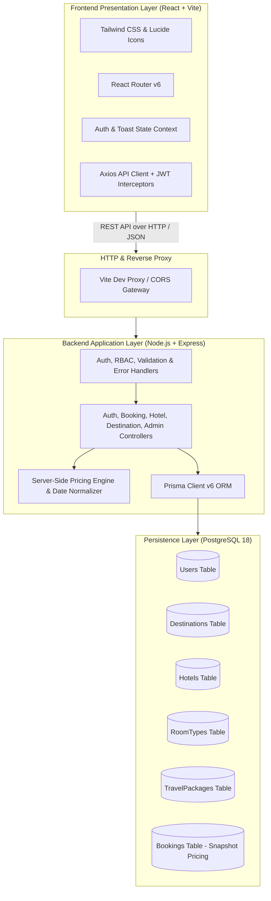

# TravelAI — Modern Full-Stack Travel Booking Platform

**TravelAI** is an enterprise-grade, full-stack travel booking and expedition management platform engineered with modern web technologies, responsive UI/UX design, server-side validated pricing, and role-based access control (RBAC).

---

## 🏛️ System Architecture

TravelAI is designed following a **decoupled, layered client-server architecture** with a clear separation of concerns between presentation, business logic, persistence, and security layers.



---

## 🏗️ Architectural Pillars

### 1. Presentation Layer (Frontend)
- **Framework**: React 18 SPA powered by Vite for instant Hot Module Replacement (HMR) and optimized rollup production bundles.
- **Routing**: React Router v6 configured with nested layouts:
  - `MainLayout`: Public navigation bar, responsive drawer, content viewport, and global footer.
  - `AdminLayout`: Protected dashboard sidebar, statistics header, and CRUD views.
- **Global State Management**: React Context API (`AuthContext` and `ToastContext`) managing persistent token authentication, user profile state, and toast notifications.
- **API Interceptors**: Axios HTTP client configured with automatic `Authorization: Bearer <token>` injection and centralized 401 session expiration handling.
- **Design System**: Tailored light theme with ocean blue (`#0284c7`) and tropical teal (`#14b8a6`) accents, typography (`Inter` & `Plus Jakarta Sans`), glassmorphism, responsive cards, and loading skeletons.

### 2. Business Logic Layer (Backend)
- **Runtime**: Node.js with Express.js RESTful API architecture.
- **Layered Structure**:
  - `routes/`: Declarative endpoint routes for authentication, catalog exploration, bookings, and admin endpoints.
  - `middleware/`: Centralized request validation, JWT authentication (`authenticate`), role-based authorization (`authorizeAdmin`), and centralized error handling (`errorHandler`).
  - `controllers/`: Core domain handlers orchestrating input validation, business logic, and database operations.
  - `utils/`: JWT generation/verification, booking reference generators (`TRV-YYYY-XXXXX`), and Prisma singleton instance.

### 3. Server-Side Price Verification Engine
- **Zero Client Trust**: All pricing computations are strictly verified and calculated on the server to prevent tamper attacks.
- **Dynamic Math Engine**: Calculates subtotal, municipal tourism tax (10%), and service fee (5%) derived directly from database rate snapshots and date differences.
- **DST-Resilient Date Math**: Implements `Math.round` time-difference normalization across ISO boundaries to guard against daylight-saving hour variations.
- **Historical Immutability**: Stores `unitPriceSnapshot`, `subtotal`, `taxAmount`, `serviceFee`, and `totalAmount` on every booking record so that future hotel/package price changes never mutate past transaction records.

### 4. Database Layer (PostgreSQL & Prisma ORM)
- **Relational Integrity**: Strict foreign-key cascades and indexes on high-frequency lookup fields (`email`, `destinationId`, `bookingReference`, `status`).
- **Data Models**:
  - `User`: Accounts with bcrypt-hashed passwords (salt rounds: 10) and `Role` enum (`USER`, `ADMIN`).
  - `Destination`: Curated global cities/islands with price estimates and highlights.
  - `Hotel`: Luxury properties with star ratings, addresses, and amenity tags.
  - `RoomType`: Hotel room inventory with capacity constraints, bed configurations, and nightly rates.
  - `TravelPackage`: All-inclusive expedition packages with day-by-day itineraries and capacity limits.
  - `Booking`: Unified reservation record supporting both `HOTEL` and `PACKAGE` workflows with snapshot pricing and demo payment verification.

---

## 🔒 Security Architecture

1. **Authentication**: Stateless JSON Web Tokens (JWT) signed with SHA-256 HMAC and configured expiration (`7d`).
2. **Password Hashing**: Industry-standard `bcryptjs` one-way hashing with salt rounds.
3. **Role-Based Access Control (RBAC)**: Server-side authorization middleware (`authorizeAdmin`) preventing non-administrators from accessing CRUD APIs or user statistics.
4. **Data Isolation**: Customers can only view, fetch, or cancel their own personal booking records (`userId === req.user.id`).
5. **CORS & Environment Protection**: Configurable allowed origins via `.env` with support for secure cookies and authorization headers.

---

## 📋 Comprehensive Public & Admin Pages

| # | Page Route | Type | Description |
|---|------------|------|-------------|
| 1 | `/` | Public | Hero search, popular destinations, featured hotels, packages, testimonials, newsletter |
| 2 | `/destinations` | Public | Search, continent filters, price sorting, and paginated destination cards |
| 3 | `/destinations/:id` | Public | Photo gallery, travel essentials, related hotels and packages in destination |
| 4 | `/hotels` | Public | Hotels catalog with star rating filter, city search, and price sorting |
| 5 | `/hotels/:id` | Public | Property gallery, full amenities list, room types inventory with direct booking |
| 6 | `/packages` | Public | All-inclusive travel packages with category, duration, and destination filters |
| 7 | `/packages/:id` | Public | Daily itinerary timeline accordion, inclusions/exclusions, remaining capacity |
| 8 | `/book` | Authenticated | Server price calculation preview, guest details, and demo checkout |
| 9 | `/booking-confirmation/:id` | Authenticated | Printable digital receipt, unique reference code, price snapshot breakdown |
| 10 | `/login` | Public | JWT login with demo customer and administrator quick-autofill shortcuts |
| 11 | `/register` | Public | Account registration with immediate session authentication |
| 12 | `/my-bookings` | Authenticated | User reservation history, status filtering, and booking cancellation modal |
| 13 | `/profile` | Authenticated | Edit name, contact phone, avatar URL, and change password securely |
| 14 | `/about` | Public | Mission statement, trust badges, key statistics, and leadership team |
| 15 | `/contact` | Public | Concierge inquiry form, corporate headquarters contact, and interactive FAQ |
| 16 | `*` (404) | Public | Travel-themed error recovery page with navigation back to safety |
| 17 | `/admin` | Admin Protected | Executive metrics overview, gross revenue, recent bookings audit table |
| 18 | `/admin/destinations` | Admin Protected | Destinations management table with Create, Edit, and Delete modals |
| 19 | `/admin/hotels` | Admin Protected | Hotels management, property edit, delete, and room type inventory modal |
| 20 | `/admin/packages` | Admin Protected | Travel packages management, multi-day itinerary editor, capacity settings |
| 21 | `/admin/bookings` | Admin Protected | Complete bookings ledger with status updater (Confirmed, Completed, Cancelled) |
| 22 | `/admin/users` | Admin Protected | Registered travelers directory with role badges and account creation audit |

---

## 🚀 Local Setup & Execution Guide

### Prerequisites
- Node.js (v18+ or v20+)
- PostgreSQL (v14+) running locally on port `5432`

### 1. Configure Environment Variables
Inside `server/.env`:
```env
PORT=5000
NODE_ENV=development
DATABASE_URL="postgresql://postgres@localhost:5432/travelai?schema=public"
JWT_SECRET="travelai_super_secret_jwt_key_2026_dev_secure"
JWT_EXPIRES_IN="7d"
CLIENT_URL="http://localhost:5173"
```

Inside `client/.env`:
```env
VITE_API_URL="/api"
```

### 2. Windows PowerShell Setup Commands

```powershell
# 1. Install dependencies
npm --prefix server install
npm --prefix client install

# 2. Synchronize Prisma Schema to PostgreSQL
cd server
npx prisma db push

# 3. Seed Database with Realistic Sample Data
node prisma/seed.js

# 4. Run Automated Backend Test Suite (16/16 Passed)
npm test

# 5. Start Backend Server (Runs on http://localhost:5000)
npm run dev

# 6. Start Frontend Client (In separate terminal, runs on http://localhost:5173)
cd ../client
npm run dev
```

---

## 🔑 Demo Login Credentials

| Role | Email | Password | Access Privileges |
|------|-------|----------|-------------------|
| **Administrator** | `admin@travelai.com` | `Admin@123456` | Full platform access + `/admin` management console |
| **Demo Customer** | `demo@travelai.com` | `Travel@123456` | Customer booking, reservation history, profile |

*(Both accounts feature 1-click autofill buttons directly on the Login page).*

---

## 🧪 Automated Testing Status

The backend includes a comprehensive Jest & Supertest integration suite covering:
- `GET /api/health` health verification
- `POST /api/auth/register` regular user role assignment
- `POST /api/auth/login` JWT generation and password rejection
- `GET /api/auth/me` authenticated profile inspection
- `GET /api/destinations` and `GET /api/hotels` public browsing
- `POST /api/admin/destinations` 403 Forbidden enforcement for non-admins
- `POST /api/admin/destinations` 201 Created for verified administrators
- `POST /api/bookings/calculate` server-side 10% tax and 5% fee validation
- `POST /api/bookings` unique reference creation (`TRV-YYYY-XXXXX`)
- `GET /api/bookings/:id` cross-user authorization privacy checks
- `PATCH /api/bookings/:id/cancel` self-service refund cancellation workflow

**Result**: **16 Tests Passed (100% Pass Rate)**.
